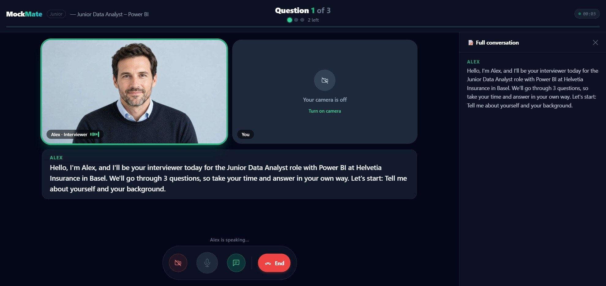
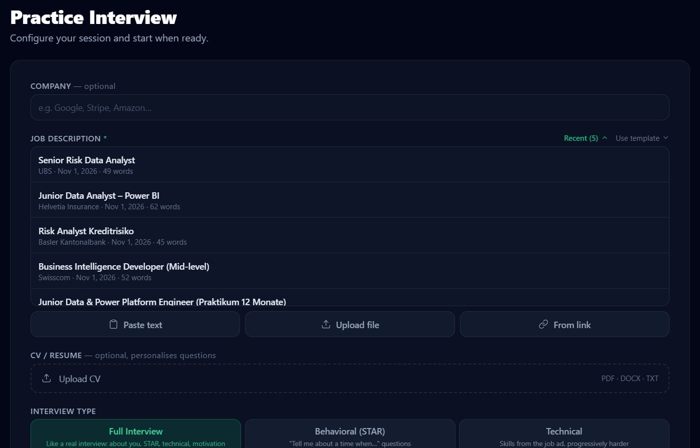
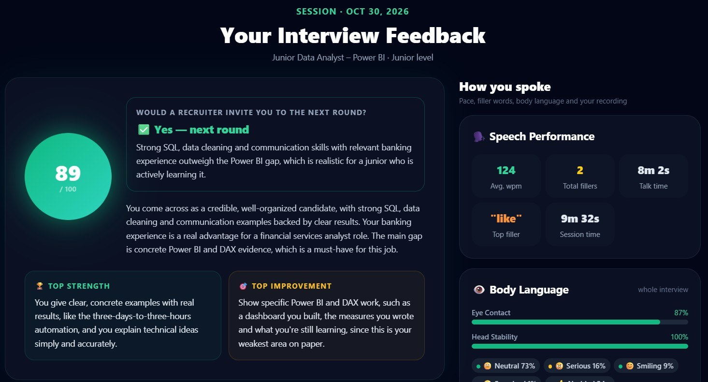
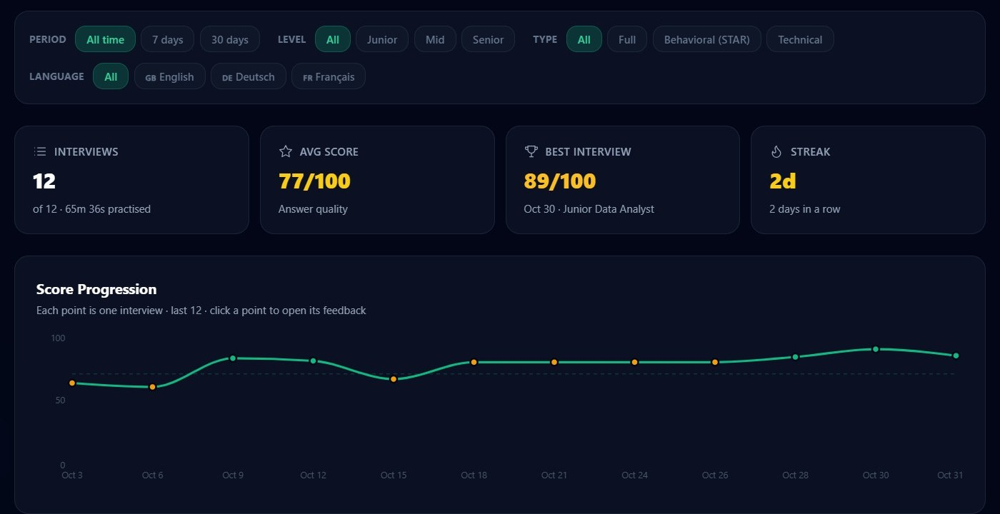
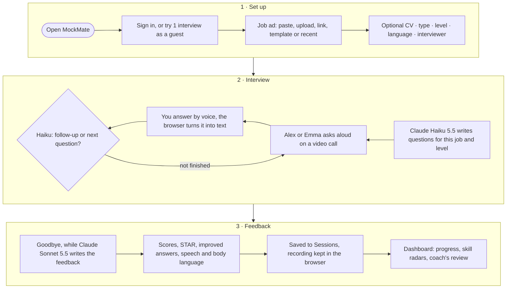

# MockMate — AI Interview Coach

Practise job interviews out loud with an AI interviewer who looks, listens and talks like a real one. Paste a job ad, answer by voice, and get feedback scored for your level: what you said, how you said it, and how you came across on camera.

**[Live demo](https://mockmate-hk93.onrender.com)** — try one interview without signing up · **[Presentation (PDF)](MockMate_AI%20Interview%20Coach.pdf)**

> Use Chrome or Edge, because the app relies on their speech recognition. The demo runs on a free server, so the first action after a quiet period can take up to a minute while it wakes up.



| Set up | Feedback | Dashboard |
|---|---|---|
|  |  |  |

---

## How it works



---

## Features

### Interview
- **Job ad in any form:** paste text, upload PDF/DOCX/TXT, read it from a link, pick a template, or reuse one of your last 20.
- **Questions for this job and your level.** With a CV, they are about your own experience. The level you choose always wins, so an experienced person practising in a new language can still pick Junior.
- **Three types:** Full interview, Behavioral (STAR), Technical. **Three levels:** Junior, Mid, Senior. **1–10 questions.**
- **Two interviewers, Alex and Emma.** Looping video portraits, and natural ElevenLabs voices on Pro.
- **Realistic flow:**
  - follow-up questions when the example, your role or the result is missing (gentler at Junior, more probing at Senior);
  - up to 2 minutes per answer, with a wrap-up warning;
  - live captions and the full conversation beside the call.
- **Webcam recording** with the interviewer's voice mixed in.
- **Live body language:** eye contact, expression, nods, and red flags for looking or turning away, or restless movement.
- **English, German and French.**

### Feedback
- **Per answer:** relevance, examples and clarity (shown out of 100), a STAR check, written feedback, a tip, and your own answer rewritten as a strong answer for your level.
- **Scored against the level:** the same answer can be strong for a Junior and average for a Senior.
- **Speech analytics:** words per minute and filler words.
- **Body language:**
  - eye contact, head stability and expressions;
  - a **"To work on"** list with clickable moments;
  - the recording plays back with labels and a timeline.
- **Retry any question** and keep every attempt.
- **Ready fast:** the feedback is prepared while the interviewer says goodbye.

### Dashboard and Sessions
- **Filters** by period, level, type and language, shared by both pages.
- **Score progression,** one point per interview. Click a point to open that interview's feedback.
- **Two radars, latest interview against your average:**
  - **Answer Skills:** Relevance, Examples, Clarity, Structure, Fluency;
  - **Body Language:** Eye Contact, Focus, Stability, Calm, Presence.
- **Coach's review:** an AI review of the interviews shown, covering your trend, what is working, and what to practise next.
- **Sessions** reopen the full feedback. The video is only available in the browser where you recorded it.

### CV
- Upload once (PDF, DOCX, TXT). It is parsed into sections and reused to personalise questions.
- **Resume analysis** (Pro): an ATS score, section scores, strengths, improvements and missing keywords.

### Plans

| | Guest | Free | Pro — CHF 9.90 / month |
|---|---|---|---|
| Interviews | 1 trial | 3 a month (verified email) | 30 a month |
| Languages | English | English | English, German, French |
| Interviewer voice | Browser voice | Browser voice | Natural voices (ElevenLabs) |
| Feedback, speech analytics, dashboard | ✓ | ✓ | ✓ |
| Retry a question | Once | Once | Up to 5 times |
| Video recording and body language | — | — | ✓ |
| Coach's review, resume analysis | — | — | ✓ |

- **Limits are checked on the server** (`backend/plans.py`). An interview counts when it starts.
- **Signing up after the trial** keeps the trial interview.
- **Online payment is not live yet.** The upgrade dialog says so, and Pro is switched on from the admin panel.

---

## Tech stack

| Layer | Technology |
|-------|-----------|
| Frontend | React 18, Vite, Tailwind CSS, Recharts |
| Backend | FastAPI (Python), slowapi rate limits |
| AI | Claude Haiku 5.5 (live interview, questions, parsing) and Claude Sonnet 5.5 (feedback, coach's review, resume analysis), via OpenRouter |
| Speech to text | Web Speech API (built into Chrome) |
| Text to speech | ElevenLabs `eleven_v4_turbo` (Pro); the browser's speech synthesis otherwise |
| Body language | Google MediaPipe Face Landmarker, running in the browser |
| Recording | MediaRecorder + Web Audio; videos stored in the browser (IndexedDB) |
| Database | PostgreSQL |
| Email | SMTP or Brevo API, for verification and password reset |
| Hosting | Docker / Docker Compose, Render |

**Privacy by design:**
- Video and face analysis never leave the browser. The server only stores scores and the body-language timeline.
- Users give consent before any AI processing.

---

## Project structure

```
backend/
  main.py        API: interview, feedback, sessions, dashboard review, TTS
  auth.py        sign-up, sign-in, guest trial, email verification
  plans.py       what each plan includes; every limit is checked here
  prompts.py     the AI prompts (questions, interviewer, feedback, review)
  database.py    tables, migrations (run on startup) and queries
frontend/src/
  components/    pages: Homepage, Landing (setup), Interview, Debrief (feedback), Dashboard, Sessions, Settings
  hooks/         speech recognition, TTS, face analysis, recording
  utils/         plan, body language, scoring, API helpers
```

---

## Quick start (Docker)

Requires [Docker Desktop](https://www.docker.com/products/docker-desktop/).

```bash
git clone https://github.com/VolodymyrSalenko/MockMate.git
cd MockMate
cp .env.template .env      # then fill in OPENROUTER_API_KEY, JWT_SECRET and optionally ELEVENLABS_API_KEY
docker compose up --build
```

Open **http://localhost:3000** in Chrome.

---

## Manual setup

**Prerequisites:**
- Python 3.10+;
- Node 18+;
- PostgreSQL. To run only the database in Docker: `docker run -e POSTGRES_PASSWORD=postgres -p 5432:5432 postgres:16-alpine`.

```bash
# Backend — create backend/.env with the variables below
cd backend
pip install -r requirements.txt
uvicorn main:app --reload

# Frontend — in a second terminal
cd frontend
npm install
npm run dev
```

Open **http://localhost:5173** in Chrome. Speech recognition needs Chrome or Edge.

### Making yourself an admin
The admin panel lists users, switches plans (Free / Pro), deletes users and can make other users admins. The first admin has to be set in the database:

```sql
UPDATE users SET is_admin = TRUE WHERE email = 'you@example.com';
```

---

## Environment variables

**Backend (`backend/.env`)**

| Variable | Required | Description |
|----------|----------|-------------|
| `OPENROUTER_API_KEY` | ✓ | AI models via [openrouter.ai](https://openrouter.ai/keys) |
| `DATABASE_URL` | ✓ | PostgreSQL connection string |
| `JWT_SECRET` | ✓ | Any long random string; signs login tokens |
| `ELEVENLABS_API_KEY` | | Natural voices for Pro. Without it, everyone hears the browser's voice |
| `SMTP_HOST`, `SMTP_PORT`, `SMTP_USER`, `SMTP_PASSWORD`, `SMTP_FROM` | | Email for verification and password reset. **Without `SMTP_HOST`, sign-ups are verified automatically** |
| `BREVO_API_KEY` | | Send email through the Brevo API instead of SMTP |
| `FRONTEND_URL` | | Frontend address, used for CORS and email links (default `http://localhost:5173`) |
| `API_BASE_URL` | | Public backend address, used in email links |
| `POLAR_ACCESS_TOKEN`, `POLAR_PRODUCT_ID`, `POLAR_WEBHOOK_SECRET` | | Online payment (not live yet) |

**Frontend (`frontend/.env`)**

| Variable | Description |
|----------|-------------|
| `VITE_BACKEND_URL` | Backend address (`http://localhost:8000` locally) |

Never commit `.env` files. Use `.env.template` as a reference.

---

## Deploy (Render)

`render.yaml` describes both services. Set the secret variables in the Render dashboard.

1. **Database:** a PostgreSQL instance (Render or Neon). Copy its connection string.
2. **Backend:** Web Service from `backend/Dockerfile`, health check `/health`.
   - Set the backend variables above.
   - In production, set `SMTP_*` (or `BREVO_API_KEY`) so that Free requires a verified email.
3. **Frontend:** Static Site.
   - Root `frontend`, build `npm install && npm run build`, publish `dist`.
   - Add a rewrite `/*` → `/index.html`.
   - Set `VITE_BACKEND_URL` to the backend's URL.

Tables and migrations are created automatically when the backend starts.

---

## Contributors

| GitHub | Profile |
|--------|---------|
| omairtemurian | [@omairtemurian](https://github.com/omairtemurian) |
| romanandreyev-gif | [@romanandreyev-gif](https://github.com/romanandreyev-gif) |
| VolodymyrSalenko | [@VolodymyrSalenko](https://github.com/VolodymyrSalenko) |
| olha-mytrofanova | [@olha-mytrofanova](https://github.com/olha-mytrofanova) |
| yasha-sharma | [@yasha-sharma](https://github.com/yasha-sharma) |
